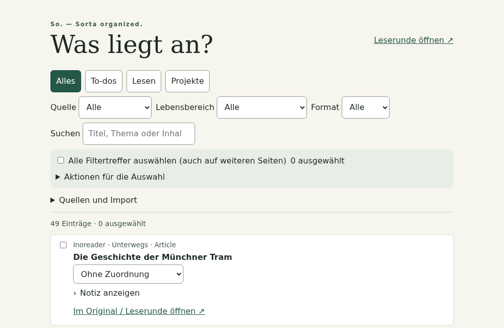

<div align="center">

# So.

**Sorta organized.**

Eine lokale Übersicht für gespeicherte Links, To-dos und Projekte. In der Leserunde entscheidest du, was auf der Liste bleibt, nach Karakeep wandert oder aus der Quelle entfernt werden soll.

[Was So. kann](#was-so-kann) · [Lokal starten](#lokal-starten) · [Quellen und Daten](#quellen-und-daten)



<sub>Die So.-Übersicht mit erfundenen Beispieldaten.</sub>

</div>

## Was So. kann

| Bereich | Was du damit machst |
| --- | --- |
| **Übersicht** | To-dos, Lesestoff und Projekte nach Quelle, Lebensbereich oder Format filtern. Links gesammelt öffnen, Einträge zuordnen oder lokal ausblenden. |
| **Leserunde** | Gespeicherte Links aus Inoreader und X durchgehen, zum späteren Lesen behalten, an Karakeep schicken oder zum Entfernen vormerken. Das Entfernen aus Inoreader oder X braucht eine separate Bestätigung. |
| **Übergabe** | Ausgewählte Einträge als Textvorschau für Hermes zusammenstellen. So. sendet nichts automatisch. |

## Lokal starten

**Nur ausprobieren?** Im geklonten Repository `python3 demo.py` starten. Die Demo öffnet den Browser mit 49 Beispieldaten auf `http://127.0.0.1:18769/`, ohne Einrichtungsdialog oder echte Konten. Mit `Ctrl+C` beenden. Beim nächsten Start sind die Beispieldaten wieder frisch. Für Updates erst die Demo stoppen, dann `git pull --ff-only` auf dem gewünschten Branch ausführen. Unter macOS den Checkout direkt im persönlichen Ordner anlegen, nicht unter Downloads oder Desktop.

Du brauchst Python 3.9 oder neuer auf macOS oder Linux und einen Browser. Der Server nutzt die Python-Standardbibliothek.

```sh
git clone https://github.com/icon3333/So..git so
cd so
export SO_DATA_DIR="$HOME/.local/share/so/prod_data"
mkdir -p -m 700 "$SO_DATA_DIR"
python3 server.py
```

Öffne [127.0.0.1:8769](http://127.0.0.1:8769/). Die Startseite und [`/reader`](http://127.0.0.1:8769/reader) zeigen dieselbe integrierte Liste. Die früheren Cockpit-Adressen `/cockpit` und `/cockpit.html` führen ebenfalls dorthin. Einstellungen bleiben unter [`/settings`](http://127.0.0.1:8769/settings). Ohne lokale Quellen oder importierte Daten kann die Liste leer sein.

Über **Lesestoff**, **Aufgaben** und **Projekte** wechselst du den Typ direkt. **Filter** blendet Website, Bereich und Format ein; unter **Auswahl** findest du die Sammelaktionen. Bei Leseeinträgen stehen **Behalten** und **Details** direkt am Eintrag; **Weitere** enthält unter anderem Links und **Entfernen vormerken**. Das Vormerken allein ändert die Quelle nicht.

## Sources / settings setup

The settings page has one **Set up** action for each source, including Karakeep. OAuth opens a popup synchronously from that click. The same-origin callback sends `{type:'so-setup-callback', provider:'x'|'inoreader', ok:true|false}` to the opener; the page checks origin and popup identity and resumes the already-started operation once on success. It does not store secrets or automatically trigger imports/writes. X's paid identity check and any subsequent import costs require explicit cost consent. The approved import limits (max pages, posts per page, USD budget), author lookup option, and restart choice are captured at the resume click and enforced by the importer. Invalid or missing limits are rejected before OAuth or import. Karakeep's destination test does not persist its API key.

Private prerequisites are not included in this public repository: X needs a Developer App and public OAuth client ID; Inoreader needs its private trusted n8n OAuth setup; Tasks.org/Posteo needs its separately installed server-side adapter. File imports need available local folders. Enable browser popups if the OAuth window is blocked.


## Quellen und Daten

Keep-Takeout, Desktop-To-dos und Projekte bleiben Dateiimporte. Um im Dialog einen Ordner zu wählen, setze `LESELISTE_IMPORT_ROOT` auf einen separaten Importordner (nicht Checkout, Home oder Produktivdatenordner). Wähle darunter den relativen Pfad zu `Keep`, `To` oder `Projects`, teste ihn und speichere ihn erst danach. Ohne neue Konfiguration gelten die folgenden Standardpfade.

- **Lokale Quellen:** Auf dem Mac liest die Übersicht `To` und `Projects` auf dem Desktop. Mit `LESELISTE_DESKTOP` lässt sich der Desktop-Pfad vorgeben. Für einen Google-Keep-Export nutzt So. standardmäßig `~/Downloads/Takeout/Keep`; überschreiben lässt sich der Pfad mit `LESELISTE_KEEP_EXPORT`. Tasks.org über Posteo benötigt einen separaten Adapter (`LESELISTE_POSTEO_ADAPTER`).
- **Online-Quellen:** Der öffentliche Quellstand enthält keine Zugangsdaten oder privaten Workflows. Die `.example.invalid`-Adressen in [`n8n_connection.py`](n8n_connection.py) und [`karakeep_connection.py`](karakeep_connection.py) sind Platzhalter. Hinterlege echte HTTPS-Ursprünge und die n8n-Hostliste nur im privaten Deployment. Historische `hermes/`-Branches sind bereinigte Quellstände, keine lauffähigen Backups.
- **Datenordner:** `SO_DATA_DIR` muss auf einen bestehenden, absoluten Ordner namens `prod_data` außerhalb des Checkouts zeigen. Er muss dir gehören, privat sein (z. B. Modus `0700`) und darf keine Symlinks enthalten. Ohne gültigen Pfad startet der Server nicht. Artikel-Snapshots, Bearbeitungsstatus, X-Lesezeichen und -Inhalte sowie OAuth-Clientdateien gehören dorthin, nicht ins Repository. Logs bleiben auf der Konsole oder beim Supervisor.

<details>
<summary>Entwicklung und Tests</summary>

```sh
python3 -m unittest discover
node --test test_*.cjs
```

Die historische Konstruktorform `App(root, origin, state_path=None)` verwendet für Tests und bestehende lokale Aufrufer weiterhin `root` als Datenordner. Der CLI-Start verlangt dagegen `SO_DATA_DIR`. Der HTTP-Server liefert nur ausdrücklich freigegebene statische Dateien aus dem Code-Ordner aus, keine Datenordner oder Archive.

</details>

## Lizenz

Im Repository liegt keine Lizenzdatei.
